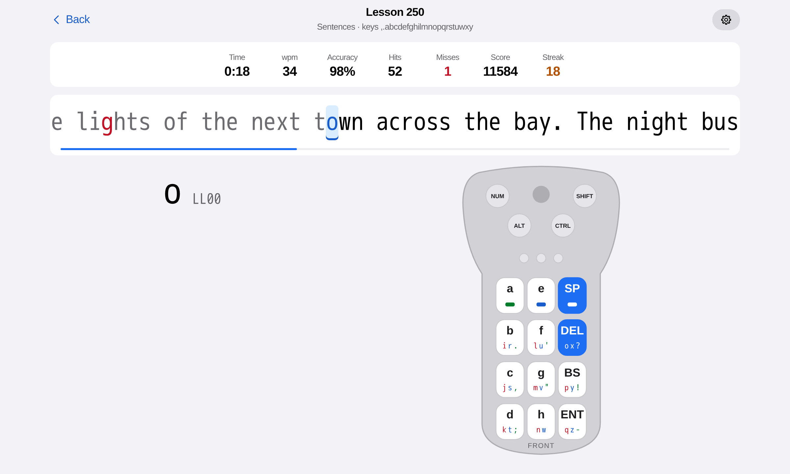
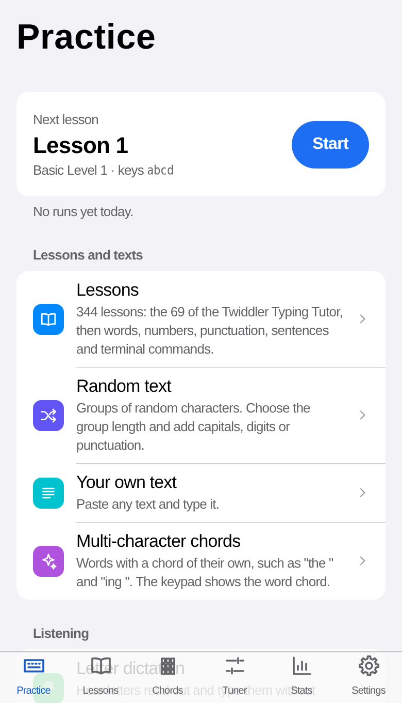
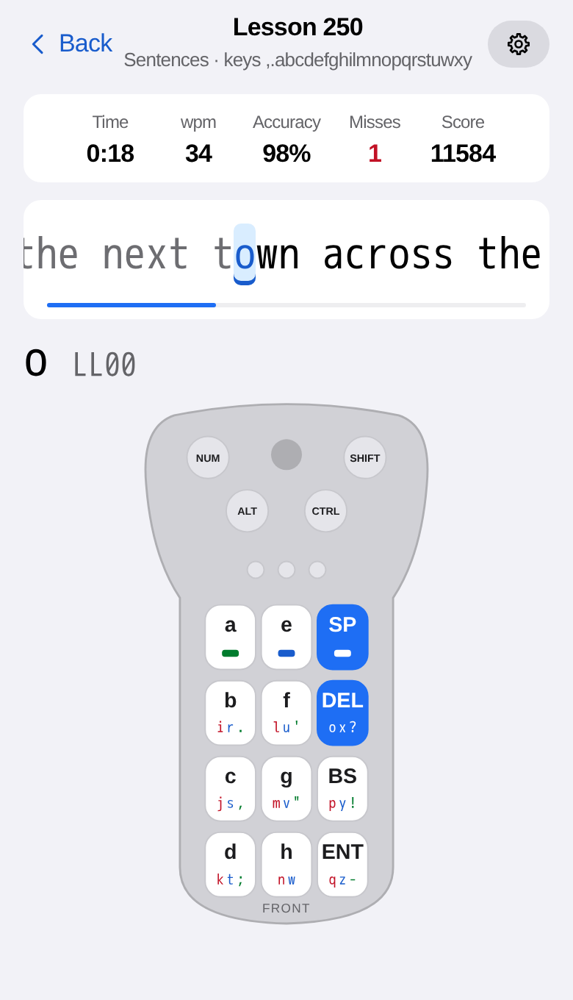
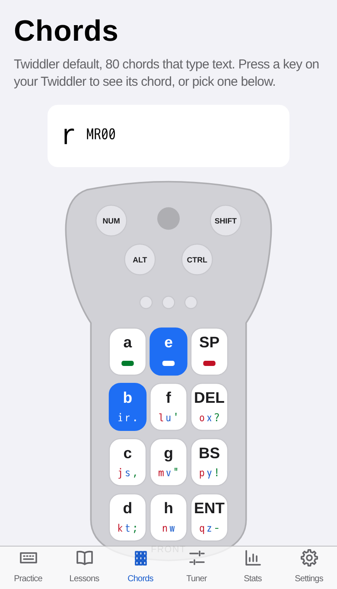
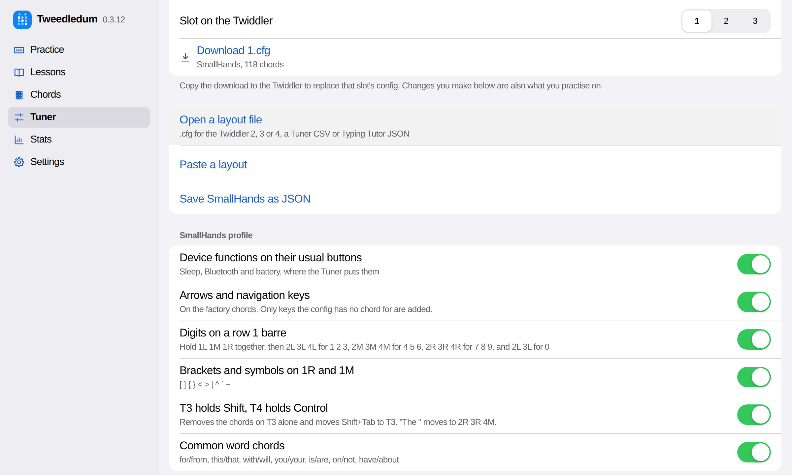

<p align="center">
  
</p>

<h1 align="center">Tweedledum</h1>

<p align="center">
  A typing tutor for the <a href="https://mytwiddler.com">Twiddler</a>, a one-handed chording keyboard.
</p>

<p align="center">
  <a href="https://nnamon.github.io/tweedledum/"><b>Open the app</b></a>
  &nbsp;·&nbsp;
  <a href="CHANGELOG.md">Changelog</a>
  &nbsp;·&nbsp;
  <a href="https://github.com/nnamon/tweedledum/releases">Releases</a>
</p>

<p align="center">
  <picture>
    <source media="(prefers-color-scheme: dark)" srcset="assets/screenshots/run-desktop-dark.png">
    
  </picture>
</p>

On a Twiddler you type a letter by pressing a few of its 12 finger buttons at once, and you have to learn which buttons make which letter. Tweedledum shows the text to type and lights the next chord on a picture of the keypad. It starts with the 69 lessons of Tek Gear's own Typing Tutor and carries on with 275 more, then adds drills, dictation and statistics.

It runs in the browser, installs as an app and works offline after the first visit. The Twiddler types into the page like any other keyboard, so there's nothing to pair or install. Your progress stays in the browser and nothing is sent to a server.

## Getting started

1. Connect the Twiddler to your computer or phone as a keyboard.
2. Open <https://nnamon.github.io/tweedledum/>.
3. Press Start. Lesson 1 teaches a, b, c and d, and finishing a lesson moves you on to the next.

To keep it on your home screen or dock, use your browser's Install or Add to Home Screen.

## Practice

<p align="center">
  <picture>
    <source media="(prefers-color-scheme: dark)" srcset="assets/screenshots/practice-phone-dark.png">
    
  </picture>
  &nbsp;
  <picture>
    <source media="(prefers-color-scheme: dark)" srcset="assets/screenshots/run-phone-dark.png">
    
  </picture>
  &nbsp;
  <picture>
    <source media="(prefers-color-scheme: dark)" srcset="assets/screenshots/chords-phone-dark.png">
    
  </picture>
</p>

The 344 lessons run in this order. You can start any of them from the Lessons tab.

| Lessons | Stage | Source |
| --- | --- | --- |
| 1–29 | Basic Level 1 | Tek Gear's Typing Tutor |
| 30–45 | Basic Level 2 | Tek Gear's Typing Tutor |
| 46–69 | Basic Level 3 | Tek Gear's Typing Tutor |
| 70–119 | Common words, from the 1,000 most common | Tweedledum |
| 120–144 | Letter groups | Tweedledum |
| 145–159 | Capitals | Tweedledum |
| 160–179 | Numbers | Tweedledum |
| 180–199 | Punctuation | Tweedledum |
| 200–259 | Sentences | Tweedledum |
| 260–284 | Terminal commands and code | Tweedledum |
| 285–314 | Common phrases | Tweedledum |
| 315–329 | Speed sprints | Tweedledum |
| 330–344 | Mixed review | Tweedledum |

The Practice tab has these exercises besides the lessons:

| Exercise | What you do |
| --- | --- |
| Random text | Type groups of random characters. You choose the group length and whether capitals, digits and punctuation appear. |
| Your own text | Paste any text and type it. |
| Multi-character chords | Type words that have a chord of their own, such as `the ` and `ing `. |
| Letter and word dictation | The app reads the text out and hides it, and you type what you hear. Letters are recorded clips that work offline; words use your device's speech voice. |
| Learn chords | One chord at a time with spaced repetition, for word chords, letters, digits or symbols. A word chord counts only when its letters arrive in one burst, so typing the word letter by letter doesn't pass. |
| Weak keys | A drill built from the characters you miss most and type slowest. |
| Timed test | Common words until the time runs out, from 30 s to 5 min. |
| Chord reading | The keypad shows a chord with its labels hidden, and you type the character it makes. |

The Chords tab lists every chord of the layout you're using. Press any key on the Twiddler there and it shows you the chord for it.

Settings changes how the keypad is drawn: from the front or the back, mirrored if you wear the Twiddler on your left hand, and with the next chord shown always, after a pause, after a miss or never. The Settings button on the run screen pauses the run, so you can change these without losing your place.

Stats shows this session, each past session and all time, with speed by day and the accuracy and timing of each character.

## Layouts

The default layout is the one the Twiddler 3 and 4 ship with, and the one the Typing Tutor teaches. To practise on another, tick it at the top of the Tuner tab. These are built in:

| Layout | By |
| --- | --- |
| Twiddler default | Tek Gear |
| SmallHands | Tweedledum, described [below](#smallhands) |
| TabSpace | Brandon Rhodes |
| MirrorWalk, with and without multi-character chords | Griatch |
| DelEnt | Griatch |
| TeaSan | Griatch |

Open a layout file reads your own layout from any of these:

- A Twiddler config file: version 4 (Twiddler 2), 5 (Twiddler 3) or 7 (Twiddler 4).
- A CSV exported by the Twiddler Tuner.
- The Typing Tutor's JSON key map.

Practice uses only the chords that type text, so shortcuts, mouse actions and chords with two buttons in one row are left out of the lessons. The lessons introduce letters in an order chosen for the default layout, and on another layout that order won't follow your chords.

## Tuner

<p align="center">
  <picture>
    <source media="(prefers-color-scheme: dark)" srcset="assets/screenshots/tuner-desktop-dark.png">
    
  </picture>
</p>

The Tuner tab edits Twiddler 4 config files (version 7) in the browser. The config file is always the ticked layout, so every change you make to it also changes what you practise on. You can:

- Open a `.cfg` saved by Tek Gear's Tuner and edit it as it is.
- Add, change and delete chords, including multi-character ones and keys with modifiers.
- Swap two thumb buttons in every chord, or mirror the whole layout to the other hand.
- Set the thumb modifiers, the small buttons above the keypad and the device settings (button mode, key repeat, haptics, sleep time, touchpad).

Device functions such as Sleep and Clear Bluetooth stay on their buttons, because Tek Gear's Tuner puts them back if they move.

The Twiddler 4 reads its configs from `1.cfg`, `2.cfg` and `3.cfg`. Pick the slot before you download and the file gets that name, so you can copy it straight across.

Every file the editor has been tested against comes back byte for byte when opened and saved: the 18 test files from [nevinera/twiddling](https://github.com/nevinera/twiddling), the factory file and two Tuner downloads, one with more than 255 bytes of multi-character strings. Tek Gear hasn't published the version 7 format, so the editor follows nevinera/twiddling's description of it.

## SmallHands

SmallHands is a layout for hands that can't reach the two far thumb buttons, T1 and T2. It is the Twiddler default with a profile applied, and each part of the profile has its own switch in the Tuner. Applying it lists what was added, moved and removed and warns about anything you can no longer type. Undo takes the whole profile back.

**Digits** go on a row 1 barre: one finger held across 1L, 1M and 1R, plus the buttons below. Tek Gear's Tuner reads the barre and shows it as `1|`.

| With the barre | L column | M column | R column |
| --- | --- | --- | --- |
| Row 2 | 1 | 4 | 7 |
| Row 3 | 2 | 5 | 8 |
| Row 4 | 3 | 6 | 9 |
| 2L and 3L together | 0 | | |

**Brackets and symbols** that needed a far thumb (`[ ] { } < > | ^` and the backtick and tilde) move to chords on 1R and 1M.

**Shift and Control** swap places: T3 holds Shift and T4 holds Control, so a capital is T3 with the letter chord. The lessons, the Chords tab and the keypad picture all show it that way.

**"The "** moves to 2R 3R 4M, the "the " chord with the little finger added. The Twiddler keeps Shift held for every letter of a multi-character chord typed with the Shift thumb, so on a thumb chord it came out as "THE ".

**Word chords** cover the 14 words that save the most typing in Peter Norvig's counts of English web text. They come in pairs. The index, middle and ring fingers make a shape in the L and M columns, then the little finger picks the word: 4M for the first, 4R for the second. Each chord types the word and a space.

| Index, middle, ring | Little finger on 4M | Little finger on 4R |
| --- | --- | --- |
| 1M 2L 3L | for | from |
| 1M 2L 3M | this | that |
| 1L 2M 3L | with | will |
| 1L 2M 3M | you | your |
| 1L 2L 3M | is | are |
| 1M 2M 3L | on | not |
| 1L 2L 3L | have | about |

The seven shapes are the ones that scored easiest in a hand test on a Twiddler 4.

Tweedledum builds SmallHands in the browser from the default layout, so Tek Gear's factory file stays out of this repository.

## Moving your progress

Progress lives in the browser's storage. To carry on in another browser or on another device:

1. In Settings, under Progress, press Copy progress code or Save progress file. The code is one line of text starting `TWD1.`, holding your settings, layout, runs and statistics.
2. In the other copy of the app, paste the code under Load progress and press Load code, or press Load progress file.

Loading replaces the progress in that browser, and the app asks before it does.

## Chord notation

A chord is written with one letter per row, row 1 (index finger) first: `L`, `M` or `R` for the button held and `0` for none. Thumb buttons come first, before a `+`.

| Written | Hold |
| --- | --- |
| `R000` | R on row 1 |
| `L0R0` | L on row 1 and R on row 3 |
| `N+R000` | NUM with R on row 1 |

L, M and R are named as you look at the front of the keypad, as Tek Gear's documents do. Settings can switch to the Twiddler 4 notation, where the last chord is `T1 F1R`.

## Development

Everything runs in Docker, so you don't install node on the host. These commands install the dependencies, run the checks, start a dev server and run the browser tests on desktop and phone sizes:

```sh
docker compose run --rm -T dev npm install
docker compose run --rm -T dev npm test           # unit tests
docker compose run --rm -T dev npm run check      # svelte-check
docker compose run --rm -T dev npm run lint:css   # stylelint
docker compose run --rm --service-ports dev npm run dev   # http://localhost:7375
docker compose run --rm -T e2e npx playwright test        # end-to-end, desktop and phone
```

The app is Svelte 5, TypeScript and Vite, with vite-plugin-pwa. A push to `main` runs the tests, builds the app and deploys it to GitHub Pages (`.github/workflows/pages.yml`).

The screenshots in this README come from `scripts/readme-shots.spec.ts`. Run this to retake them after a change to the interface:

```sh
docker compose run --rm -T e2e npx playwright test -c readme-shots.config.ts
```

Read [AGENTS.md](AGENTS.md) before you change the code and [STYLE.md](STYLE.md) before you write docs, comments, commit messages or text in the app.

## Credits

Lessons 1 to 69 and the default layout come from Tek Gear's Twiddler Typing Tutor. Lessons 70 to 344 were written for Tweedledum and are generated by `scripts/more-lessons.py`. Tweedledum is not made by or connected with Tek Gear.

Bundled layouts, voice clips and test files are listed in [THIRD_PARTY_NOTICES.md](THIRD_PARTY_NOTICES.md). The code is under the MIT licence ([LICENSE](LICENSE)).
